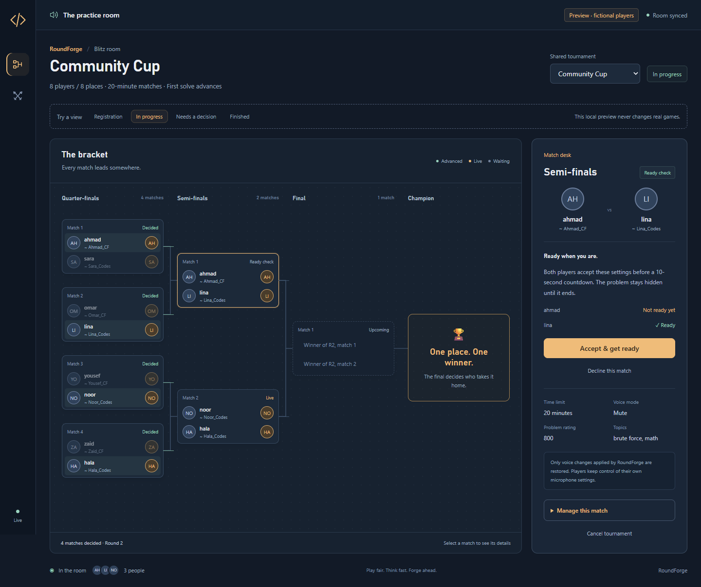
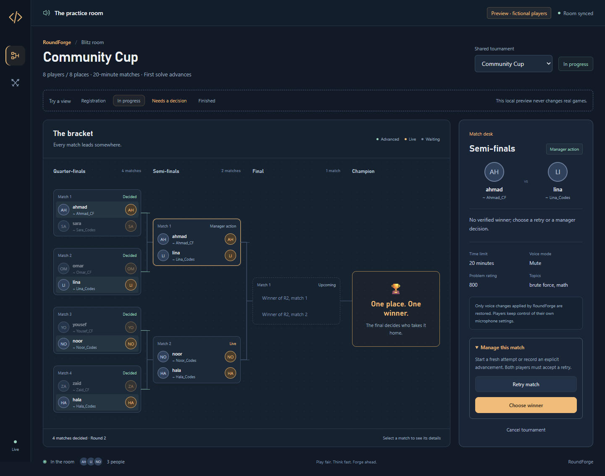

# RoundForge voice Activity



The Activity runs inside Discord's shared voice-room window. It shows the live tournament
bracket, Discord ~ CF player cards, ready checks, a countdown, the revealed problem, and a
match timer. Players can join/leave registration, accept or decline their own invitation,
and request solve checks. Hosts can start/cancel their tournament and choose the bracket
that everyone in the same Activity instance follows. Existing Blitz rules still control
problem selection, results, room reuse, and mute/deafen recovery.

## Review locally first

No Discord account, secret, SDK build, bot login, or real database is needed for this preview:

```powershell
# From the project folder, after installing requirements.txt:
.\.venv\Scripts\python.exe -m just_bot.activity_server --preview --port 8080
# Or: .\preview-activity.ps1
```

Open **http://127.0.0.1:8080**. Use the preview switches for Registration, In progress,
and Finished. Click **Accept & get ready** to test the ten-second countdown and problem reveal.
Use **Needs a decision** to try a retry or manual advancement. Open **Manage this match** on
an active pairing to change its timer or stop that match.
Select any match to inspect it; **My match** in the left rail takes you back to your pairing.
The preview uses fictional players and never changes real games. It binds only to loopback,
does not load `.env`, and is a separate process from the production bot. Stop it with Ctrl+C
before using the same port for the real Activity. It is not the server to map into Discord.

## Build the Discord SDK

On Windows, the guided setup builds the pinned SDK, then asks for the application ID and a
hidden OAuth client secret locally:

```powershell
.\setup-activity.ps1
```

If your PowerShell policy blocks local scripts, use the individual npm commands below and then
run `.\.venv\Scripts\python.exe -m just_bot.activity_setup --configure` directly. You do not
need to change your system execution policy. The setup preserves the existing bot token.

The review preview uses browser-native JavaScript. The real Discord client also needs a locally
bundled official Embedded App SDK. Use Node.js 22+ and an internet-enabled terminal:

```powershell
cd activity-client
npm.cmd install
npm.cmd run build:sdk
cd ..
```

On Linux/macOS use `npm` instead of `npm.cmd`. The build writes
`just_bot/activity_web/vendor/discord-sdk.js` and a dependency-license notice. It contains no
credentials. Keep the generated `activity-client/package-lock.json` with your source for
repeatable installs, and use `npm ci` once the lockfile exists. The generated vendor folder
and `node_modules` are ignored by Git; build the bundle before packaging or creating a Docker image.
The build retains notices for bundled dependencies and checks for their license files.
It also writes `sdk-build.json` with the resolved SDK version and bundle checksum. Startup
checks that manifest before syncing commands or enabling the Activity server.

The SDK is pinned to version 2.5.0. An optional Docker build below builds it in its own Node stage,
and the source CI includes an SDK build check. **Environment limitation:** outbound npm downloads
remain blocked in the Codex workspace. The local preview, backend, and browser flows were tested;
neither a real SDK build nor a live Discord launch was verified here. No replacement RPC SDK is used.

## Configure Discord and HTTPS

Use the **same Discord application as the bot**. The application/client ID is public;
the **OAuth2 Client Secret is different from the bot token**. Enter secrets in the local `.env`,
not in Git, browser code, screenshots, or chat.

1. Follow Discord's [first Activity setup guide](https://docs.discord.com/developers/activities/building-an-activity).
   Add an OAuth2 redirect URI as described there and configure a root URL Mapping.
2. Host the bot's Activity HTTP service behind HTTPS. Map `/` to that HTTPS hostname in
   **Activities → URL Mappings**. HTML, static files, and `/api/*` all use the same mapping.
3. Enable Activities for the application. Use Guild Install; the backend supports server
   voice rooms. Development/tester visibility and distribution are controlled by Discord.
4. Set these local environment values:

```dotenv
ACTIVITY_ENABLED=true
DISCORD_CLIENT_ID=your_application_id
DISCORD_CLIENT_SECRET=your_oauth_client_secret
ACTIVITY_HOST=127.0.0.1
ACTIVITY_PORT=8080
```

5. Start/restart the bot normally. It serves the real Activity and APIs in the same process
   as its SQLite connection. Keep the Python process and HTTPS endpoint running. The bot restores
   the Discord-handled **Launch** entry-point command after command sync, so syncing does not
   remove the App Launcher entry.

The proxy must preserve request methods, bodies, and Authorization headers. No separate API
mapping, browser API key, or browser-side bot token is needed. See Discord's
[networking guide](https://docs.discord.com/developers/activities/development-guides/networking).
Do not publish a raw bot database or map the preview server into a live app.

### Docker

Configure the local `.env` with the application ID, OAuth client secret, and bot token, then:

```sh
docker compose -f compose.yaml -f compose.activity.yaml up --build -d
```

The override listens inside the container but publishes the port only on the host's loopback
interface. `Dockerfile.activity` downloads and builds the SDK in a Node build stage, so this
deployment does not require a host-side npm build. The ordinary `Dockerfile`/base Compose flow
remains available for the bot without the Activity. Put an HTTPS reverse proxy/tunnel in front
of it. This guide does not deploy a public host or change your Developer Portal settings automatically.

## Open it with friends

1. Create a tournament with `/tournament create` and join an existing server voice channel.
2. Use `/activity tournament_id:ID` or **Open voice activity** on its tournament panel.
3. From voice-channel chat, the bot uses Discord's native Activity launch response. From text
   chat, it creates a short-lived embedded-application invite to your **existing** voice room.
   That route needs **Create Invite** for both the user and bot in the voice channel; it does not
   create another room. Without invite permission, run `/activity` in the voice channel's chat.
4. Friends join the same Activity from that voice channel. The instance shares its selected
   tournament. The host/manager can choose another visible tournament from the selector.

You can also use Discord's App Launcher from the voice room. If no tournament is selected,
the host chooses one inside the Activity. Completed and recent tournaments are available in
the selector. Tournament commands and image embeds continue working with the Activity disabled.

The Activity shows pending problems as hidden. It reveals them only after the engine marks
the match active. Timers use server time; changed tournament data is polled every 2.5 seconds
with conditional requests. It is friendly programming practice rather than an anti-cheat client.
Players still solve on Codeforces; **Open problem** uses Discord's external-link confirmation.
If voice movement is enabled, use the selected game voice room. With no explicit target, both
players join the same room before using Ready in the Activity, keeping the game from moving a
player out of the shared session. Regular bot Accept buttons retain their existing behavior.
Audio remains Discord's responsibility; the Activity does not capture microphone or camera media.

## Manager controls inside the Activity



Select a pairing, then open **Manage this match** in the match desk. Only the host, assigned
manager, or server organizer can use these controls; the server rechecks their permissions.

- **Retry match** appears for a blocked pairing. It creates a fresh invitation, with fresh player
  acceptance; a previous attempt's acceptances are not reused.
- **Choose winner** appears for a blocked pairing. Select one of its actual players, then confirm
  the advancement. The bracket records a manager decision instead of claiming a verified solve.
- **Change timer** appears on active matches. Enter total minutes from the original start or
  select unlimited time. Applying an already elapsed deadline asks for confirmation and releases
  the bot's voice effects while verification settles. It does not add minutes to the current clock.
- **Stop this match** stops only the selected duel, restores bot-owned voice effects, and makes
  the pairing available for retry or manual resolution. It has a separate confirmation from
  cancelling the whole tournament.

Old dialogs cannot silently modify a new match attempt or overwrite a changed timer: the API
compares the reviewed match ID/deadline again inside the engine lock. The selected match's actual
timer is shown in its rules, even when it differs from the tournament's default duration.

## Check live readiness

These checks report missing pieces without printing credential values:

```powershell
.\.venv\Scripts\python.exe -m just_bot.activity_setup
.\.venv\Scripts\python.exe -m just_bot.activity_setup --online --public-url https://your-host.example
```

Use `--json` for a machine-readable report. Local checks verify the SDK bundle/checksum/notices,
credential presence, port, and enable flag. Online checks verify the bot/application ID match,
Activities flag, real HTTPS config, unauthenticated API denial, and the hosted SDK checksum.
They do not certify the OAuth client secret or the URL Mapping: test an actual Discord sign-in
and a two-player match after configuring those. A second real Discord member/tester is needed
for the multiplayer check. No account settings or hosting resources are changed by the checker.

## Access and data boundaries

- OAuth requests only `identify`. The server validates the token's application and user with
  Discord, then verifies the actual Activity instance and its server/channel/users with the bot API.
- The backend does not trust client-provided guild IDs, user IDs, permissions, or match outcomes.
  Instance membership and server permissions are rechecked before actions. Read checks use
  short caches; a viewer must also be allowed to see the tournament's text channel.
- Only an invited player can accept for themselves. Hosts cannot accept on behalf of players.
  Ready requests include the settings revision. Game and tournament controls use the existing engines.
- Browser tokens stay in memory, not URLs/localStorage. Server sessions expire after at most
  thirty minutes and are not persisted. Reconnect when a session expires or the bot restarts.
- Shared instance/channel selections persist in SQLite. Old instance rows are pruned after
  a week of inactivity; channel presets remain until replaced or removed by the operator.
- The production app never switches to preview data because of a URL parameter or an auth error.
  Static routes serve only the explicitly listed web assets, not repository or runtime files.

Discord's [multiplayer guide](https://docs.discord.com/developers/activities/development-guides/multiplayer-experience)
describes the shared instance and instance-verification API used here.

## Checks

```sh
python -m unittest discover -s tests -q
node --test tests/activity_model.test.mjs
```

`scripts/check_activity_ui.cjs` is an optional Playwright browser check against the local preview.
It covers desktop/mobile layout, match selection, ready/countdown/reveal, signup/start, the champion,
and cancellation confirmation. It accepts `PLAYWRIGHT_MODULE` and `ACTIVITY_BROWSER` paths when
Playwright or a browser is supplied by your development environment.
