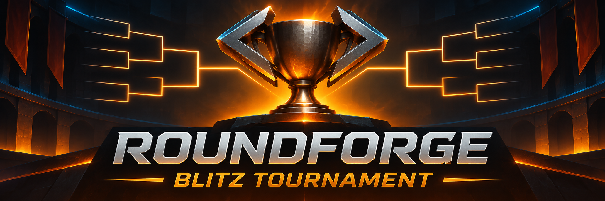
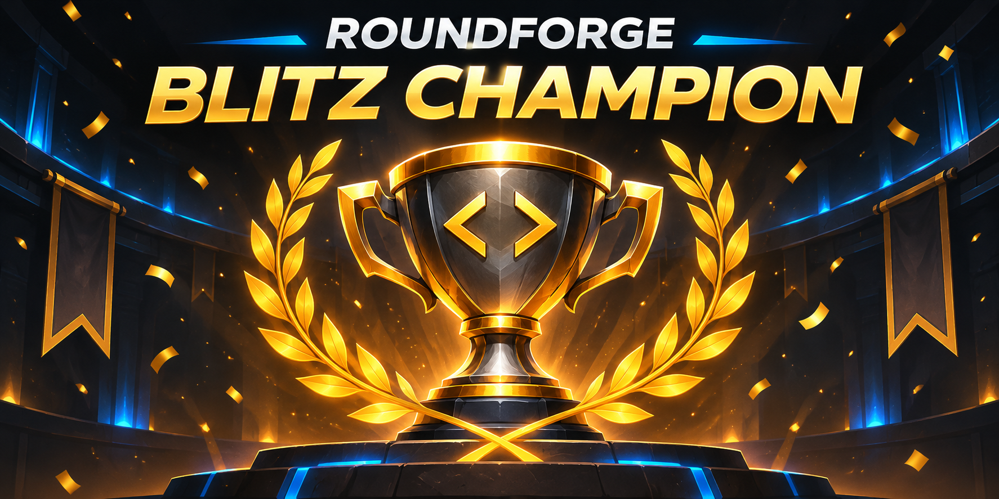
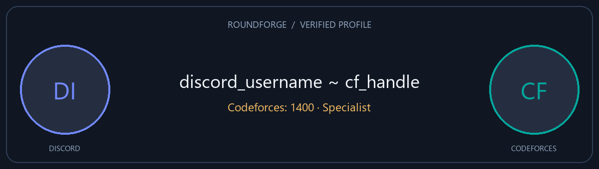

# Blitz tournaments and profile cards



## Create and register

An organizer with **Manage Server** creates a tournament in an accessible text channel:

```text
/tournament create name:Community Cup capacity:16 minutes:20 rating:1200 voice_mode:mute
```

The public panel has **Join**, **Leave**, **Start tournament**, **Cancel tournament**, and
**Bracket / status** buttons. Players need verified Codeforces accounts. Only the host, the
assigned manager, or a server organizer can start, cancel, retry, or resolve matches.
Grant the bot **Attach Files** and **Embed Links** for the artwork, plus the voice permissions
for the mode you enable. Channels must be accessible to the participants and managers.

Options:

| Option | Behavior |
| --- | --- |
| `capacity` | 2–32 players; default 16 |
| `minutes` | Per-match duration, 1–180; omitted means unlimited |
| `rating` | Exact problem rating, a multiple of 100 between 800 and 3500; omitted is automatic |
| `topics` | Comma-separated named topics, e.g. `dp,graphs,greedy`; matches any selected topic |
| `random_topic` | Random topic per duel; cannot be combined with selected topics |
| `voice_mode` | `none`, `mute`, `deafen`, or `both`; default mute |
| `voice_channel` | Optional existing voice channel; otherwise normal Blitz room reuse applies |
| `move_voice` | Whether to move players to the selected voice room; default true |
| `manager` | Optional delegated manager; does not automatically join as a player |

Use **Join** or `/tournament join tournament_id:ID`. You can leave before the bracket starts.
Registration reserves your account for this tournament, preventing overlapping games/events.
Finish any current Blitz invite/game and pending voice recovery before joining. Leaving signup,
being eliminated, finishing, or cancelling the event releases the tournament reservation.
Outstanding bot-owned voice recovery remains protected by the normal Blitz player slot.

The host and manager do not need linked CF accounts unless they join as players. At most five
open tournaments are allowed per server. Each server has independent brackets and reservations.

## Play and advance

Click **Start tournament** after at least two players join. Seeding is randomized once and saved.
The bracket automatically distributes byes for fields such as 3, 5, or 12 players. Byes never
create fake games or voice changes.

Each real pairing creates a normal 1v1 Blitz invitation. **Both players accept** its settings;
then the visible 10-second countdown runs before the problem is revealed or voice effects begin.
Each duel uses first-solve rules. Suitable existing channels are reused. Multiple pairings can
run simultaneously. Fresh eligible problems are chosen per pairing; manual problems are not
supported because later rounds must avoid previously solved problems.

A verified winner advances automatically. Once all pairings in a round are decided, the next
round is created. The final winner becomes champion and the public panel switches to the
champion artwork. Separate tournaments may run concurrently with different participants.

View the current bracket with **Bracket / status**, or:

```text
/tournament list
/tournament bracket tournament_id:ID
/tournament bracket tournament_id:ID round_no:1
```

## Draws, forfeits, retries, and cancellation

A draw, expired/declined invitation, timeout without a winner, interrupted game, or unverified
result blocks that pairing. The bot never randomly promotes a player. Managers can choose:

```text
/tournament retry tournament_id:ID round_no:1 match:2
/tournament resolve tournament_id:ID round_no:1 match:2 winner:@Alice
```

`match` is the numbered pairing in that round. Retry creates a new invitation with fresh consent
and a fresh eligible problem. Resolve explicitly records a manager decision; the chosen player
must belong to that pairing. The bracket displays the manual decision separately from a verified
result. A running duel must first end or be cancelled before it can be resolved. Allow a clock
tick (about five seconds) for its result to reach the bracket.

Cancel the whole event with **Cancel tournament** or `/tournament cancel tournament_id:ID`.
This cancels its Blitz games and restores bot-owned voice changes. Disconnected players retain
their recovery records until Discord lets the bot restore their voice state.

Brackets, registrations, reservations, and game links persist across restarts. Existing signup
buttons are restored. Active Blitz games follow the normal recovery rules; a clean bot shutdown
cancels duels, so the tournament manager may need to retry interrupted pairings after restarting.
Artwork delivery failures remain queued for retry even after the tournament has finished.



## Your Discord ~ Codeforces profile card

```text
/handle show
/handle show member:@Alice
```

The profile command now attaches a card in this layout:

**Discord avatar · Discord username ~ Codeforces handle · Codeforces avatar**

It uses the real avatars, rating, and CF rank of the verified linked account. Missing or
unavailable avatars fall back to initials. No avatar photos are stored on the bot's disk;
the rendered image is uploaded to the command's Discord channel. Without Attach Files
permission, the ordinary text/embed profile remains available.

Illustrative preview with placeholder names and initials:



Artwork prompts and provenance: [assets/README.md](just_bot/assets/README.md).
